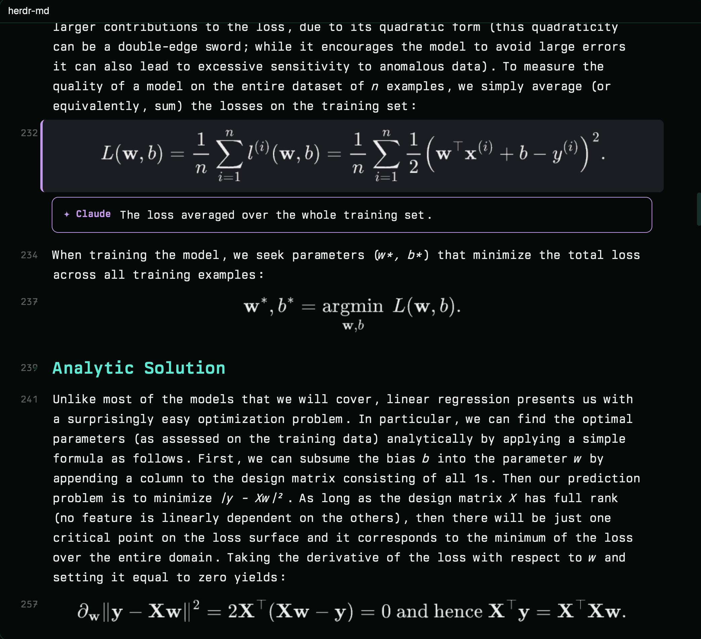

# herdr-md

Finally, markdown and the terminal done right: a native markdown pane for the
[Herdr](https://herdr.dev) desktop app, drawn in your theme next to your shell.



- **Reads like a real document.** Heading sizes and colors from your Herdr
  theme, your terminal font, tables, task lists, `> [!NOTE]` callouts, and code
  blocks with syntax colors and a copy button.
- **Math and diagrams in place.** MathJax typesets `$$…$$`, inline `$…$`
  becomes Unicode (`ŷ = wᵀx + b`), ` ```mermaid ` fences render in your
  theme's colors, and d2l-book `:eqref:` / `:numref:` roles become working
  cross-references.
- **Moves like vim.** A block cursor with counts (`5j`), smooth glide
  scrolling, folding (`za`), an outline (`o`), search (`/`), and `.md` links
  that open in place with `Backspace` to go back.
- **Shows what changed.** Save the file and the pane glides to the first
  edited block and marks each one in the gutter, even across sessions ("3
  changed since you last looked"). `]` / `[` step through them.
- **Bonus: works with AI.** Your agent runs `mdh hl FILE --lines 40-52 --note
  "…"` to highlight and annotate; you pin blocks with `V` then `p`, and `mdh
  sel` hands it the lines you meant.

## Install

Ask your agent in Herdr:

> add the mod github.com/ryanthedev/herdr-md

then put the CLI on your PATH:

```sh
ln -s ~/.config/herdr-app/mods/herdr-md/mdh ~/.local/bin/mdh
```

Or by hand:

```sh
git clone https://github.com/ryanthedev/herdr-md
cp -R herdr-md/mods/herdr-md ~/.config/herdr-app/mods/
ln -s ~/.config/herdr-app/mods/herdr-md/mdh ~/.local/bin/mdh   # the CLI for agents
```

**Needs:** Herdr desktop app. For math and Mermaid, Node.js with npm (the mod
runs `npm install` in its `render/` folder the first time it meets a formula or
diagram, about 400 MB with Mermaid's tooling) and, for Mermaid only, an
installed Chrome, Chromium, Brave or Edge (none is downloaded; set
`CHROME_PATH` if yours is elsewhere). Without them everything else works and
figures show their source. Built and tested on macOS; image sizing (`sips`) and
copy (`pbcopy`) are macOS tools.

**What it runs:** `node`/`npm` (renderers), `cp`, `mkdir`, `sips`, `pbcopy`. It
reads the file you open and the images it links, writes only inside its own
folder (`.cache/`) and `~/.cache/herdr-md/` (highlights and your selection),
and fetches nothing from the network except that one-time `npm install`.
Remote images in documents are never fetched.

Try it on the bundled tour: `mdh open demo/tour.md`.

## Open a file

```sh
mdh open README.md                  # a viewer to the right of the focused pane
```

or from any script: `herdr-app do pane.split '{"direction":"right","mod":"herdr-md","props":{"file":"/abs/path.md"}}'`.

### Click to open from the Files panel

Herdr's Files panel is a shipped mod, so change a copy of it:

```sh
herdr-app do mod.clone '{"name":"files","as":"my-files"}'
herdr-app do layout.clone '{"name":"main","as":"my-main"}'
```

In `layouts/my-main.json` set the `files` block's `content.mod` to `my-files`.
In `mods/my-files/main.js` add `run` to the `herdr` import and put this at the
top of `show(path, cx)`:

```js
if (path && cx && !this.on && /\.(md|markdown|mdx)$/i.test(path)) {
  const file = `${this.root}/${path}`, tab = focused()?.tab;
  const old = panes().find(p => p.mod === "herdr-md" && p.tab === tab);
  if (old) run("pane.close", { pane: old.pane });   // close first, or each click halves the pane
  return run("pane.split", { direction: "right", mod: "herdr-md", props: { file } });
}
```

## For agents: `mdh`

```sh
mdh open FILE [--down]
mdh hl FILE --lines 40-52 --note "why this matters"       # replaces earlier highlights
mdh hl FILE --text "a phrase from the doc" --color green  # matches the block containing it
mdh hl FILE --lines 90 --add --color red                  # --add keeps the earlier ones
mdh focus FILE 2 · mdh clear FILE · mdh show FILE
mdh sel                                                   # what the person pinned with V … p
```

Notes are markdown. Colors: yellow (default), green, red, blue, purple, cyan.
Highlights snap to whole blocks (a paragraph, heading, list item, table, code
block). For Claude Code there's a ready skill in
[`skills/md-viewer/SKILL.md`](skills/md-viewer/SKILL.md): copy it to
`~/.claude/skills/md-viewer/`.

## Keys (click the viewer first)

| Keys | |
|---|---|
| `j` `k` (counts: `5j`), `gg` `G` | move the cursor (one block is one line) |
| `ctrl-d` `ctrl-u`, `ctrl-f` `ctrl-b`, `space` | half / full page |
| `ctrl-e` `ctrl-y` | scroll a line, cursor stays |
| `{` `}` | previous / next heading |
| `]` `[` · `c` | next / previous changed block · clear the change marks |
| `o` | outline (`j`/`k`, `Enter`, `Esc`) |
| `Backspace` | back after following a link (web links open in your browser; local non-markdown files are only shown in Finder, never launched) |
| `zz` · `za` `zc` `zo` · `zM` `zR` | center · toggle/close/open fold · fold/unfold all |
| `V` then `j`/`k` | select blocks |
| `y` | copy the selection's markdown source |
| `p` | pin the selection for the agent (`mdh sel` reads it) |
| `Enter` | fold the heading, or follow the first link in the block |
| `/` then `Enter` / `Shift-Enter`, `n` `N` | search; next / previous match (or highlight) |
| `#` | line numbers on/off |
| `Esc` | leave visual mode, close search, clear the sent selection |
| `?` or `h` | key help (any key closes it) |
| `q` | close the viewer |

Clicking a heading folds it too.

## Development

Herdr hot-reloads mods on save but doesn't follow a symlinked mod folder, so
edit here and run `scripts/dev-sync.sh` to copy the mod into
`~/.config/herdr-app/mods/herdr-md` (it skips `node_modules` and `.cache`).

## License

MIT. Bundles [marked](https://github.com/markedjs/marked) (MIT,
`mods/herdr-md/marked.LICENSE.md`); MathJax and mermaid-cli are installed from
npm on first use under their own licenses.
