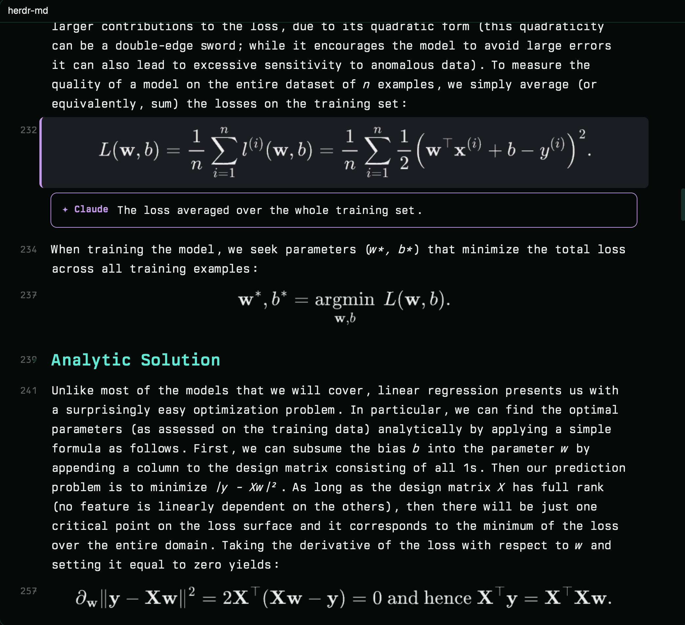

# herdr-md

A markdown file rendered natively in a Herdr pane (real heading sizes, theme
colors, tables, images, typeset math, Mermaid diagrams) that a coding agent can
drive from the shell: it highlights blocks, attaches notes and glides the view
to them, and reads back what the person selected.



## What you see

- A pane (opened with `pane.split {mod: "herdr-md", props: {file}}`) filling with the document on the theme's `background`, content column at most 960px wide, centered, 64px side padding, 28px top.
- Body text in `settings().font_family` (the person's terminal font; Geist if unset) at 15px, line height 1.65. Headings bold: H1 34px `ansi4`, H2 26px `ansi5`, H3 21px `ansi6`, H4 18px `ansi2`, H5 16px `ansi3`, H6 15px `muted`; H1/H2 get a 1px `border` rule.
- A gutter left of each block with its first source line number, 12px `dim`; the cursor block's number in `accent`, semibold.
- Code blocks: rounded 8px `surface` card with a 28px header (language left, `copy` right) over a read-only `Editor` with syntax colors from `ansi1..6`, at most 40 lines tall.
- Tables: rounded bordered card, header row on `surface` in `ansi4`, alternate rows on `canvas`; column widths weighted by content length.
- Lists: bullets `•` / numbers in `accent`; tasks `✓` (`ansi2`, text dimmed) / `○`.
- Blockquotes: 3px `ansi5` left bar, `muted` text.
- Local images at natural size, fitted to the column, at most 560px tall, with the alt text as a caption. Remote images: a placeholder (never fetched).
- `$$…$$` display math: a MathJax SVG in `foreground`, centered. Inline `$…$`: Unicode in italics. ` ```mermaid `: a PNG on a `surface` card in theme colors.
- Agent highlights: the covered blocks get a 3px left bar and a 12%-alpha tint in the highlight color, and a note card under the last block (bordered in that color, `✦ Claude` label, markdown body; numbered when there are several).
- The cursor block: `hover` background with a 3px `accent` bar. Visual selection: `selection` background. A sent selection: `ansi4` tint and bar.
- A 6px scrollbar thumb on the right; a bottom-left status (`VISUAL` badge, pending keys, brief messages like "copied").
- Search: a 340×38 floating box top right (`⌕`, input, `3/12` counter, `✕`).

## How it behaves

- Reloads when the file changes (`watchFolder` on its folder); highlights reapply.
- Highlights come from `~/.cache/herdr-md/<path-key>.json` (`{seq, focus, highlights: [{lines:[a,b]} | {text}, note?, color?]}`), written by the bundled `mdh` script and watched by the pane. A new `seq` glides to the focused highlight, unfolding sections that hide it.
- Scrolling is the mod's own viewport: content is absolutely positioned at `top(-offset)` with `.transition("top", …)`: 320ms ease-in-out for jumps (highlights, search, headings, gg/G), 120ms for cursor steps, 60ms for wheel ticks, 200ms for half pages.
- Keys (with `"focusable": true`): `j/k` (counts), `gg/G`, `ctrl-d/u/f/b`, `space`, `{ }`/`[ ]`, `zz`, `za/zc/zo/zM/zR`, `V`, `y` (copy source via `pbcopy`), `Enter` (write `~/.cache/herdr-md/selection.json`), `/` search with `Enter`/`Shift-Enter`, `n/N`, `#`, `Esc`. A click puts the cursor on that block; clicking a heading folds it.
- Figures render in one batch per load through `node render/render.mjs '<jobs JSON>'`; the first time, the mod runs `npm install` there. Outputs are cached by a hash of source and colors, so a theme change re-renders once.

## Built from

- `mods/herdr-md/main.js`: one `View`. Parses with vendored `marked` (`marked.js`) plus a block extension for `$$…$$`; top-level tokens (lists split into one block per item) become rows, each measured with `on_size_change` to place the viewport.
- `tex.js`: inline TeX → Unicode (Greek, operators, super/subscripts, `\frac`, accents) and the inline `$…$` rule (no space inside the dollars, no digit after, so prices stay text).
- Paragraph and cell text: `TextView.markdown` (inherits size and font, ignores parent color). Headings are plain text so they can be colored.
- `render/render.mjs`: MathJax (`mathjax-full`, liteAdaptor, SVG output, `currentColor` → theme foreground) and `@mermaid-js/mermaid-cli`'s `renderMermaid` on one puppeteer browser using the installed Chrome-family app, PNG at 2× with transparent background and theme variables.
- `mdh` (Python 3): `open`, `hl`, `focus`, `clear`, `show`, `sel`.
- `herdr` APIs: `props`, `readTextFile`, `watchFolder`, `exec`, `theme`, `settings`, `home`, `nextCommand`, `panes`. Programs: `node`, `npm`, `cp`, `mkdir`, `sips`, `pbcopy`.

## Watch out

- `EditorState.new` throws inside `render`: build code-block states at load.
- `image()` only loads files under the Herdr home: local images are copied to `.cache/` first.
- Sizes from `on_size_change` and wheel deltas are zoomed pixels while `top()`/`h()` take zoom-1 units: divide by `settings().zoom`.
- A mod can't write files outside the Herdr home when installed through a symlink, and Herdr won't hot-reload a symlinked mod folder: install a copy.
- `"focus"` from `nextCommand()` also arrives when a popup over the pane closes (the leader panel closes before it runs `pane.go`): take the keyboard only if `panes()` still shows this mod focused ~60ms later, or the keyboard stays behind.
- Don't name a method `render` for anything but the view, and don't store search text in a token's `text` field (it corrupts the TeX and code copy).
- Mermaid labels need a real browser; the first diagram costs ~3s for Chrome to start.

## Done when

- A README with headings, a table, a code block and an image renders with real sizes and theme colors, and the image fits a narrow pane.
- `$$\hat{y} = w_1 x_1 + b$$` shows typeset subscripts; inline `$\mathbf{x}^{(i)}$` shows `x⁽ⁱ⁾`; `$5 and $10` stays text.
- A ` ```mermaid ` flowchart renders as a picture.
- `mdh hl FILE --lines N --note "x"` glides to line N, tints it and shows the note; `mdh clear` removes it.
- `V j Enter` in the pane, then `mdh sel`, prints that file and line range.
- `/` + a word tints matching blocks and `Enter` moves between them; clicking a heading folds its section.
- Leaving the pane with the leader prefix (`ctrl-space h`) moves the keyboard on the first press.
