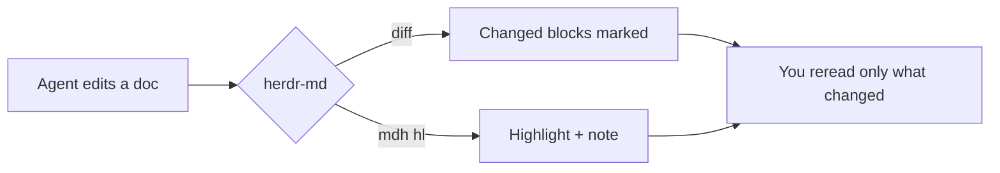
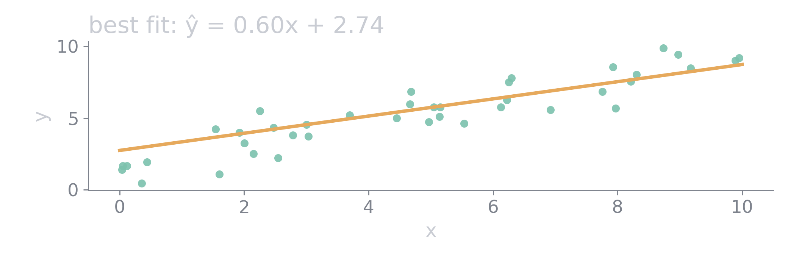

# herdr-md

Markdown rendered natively in a Herdr pane: real type, your theme's colors,
images, math and Mermaid diagrams, with APIs for AI to read, highlight and
annotate the document alongside you.

