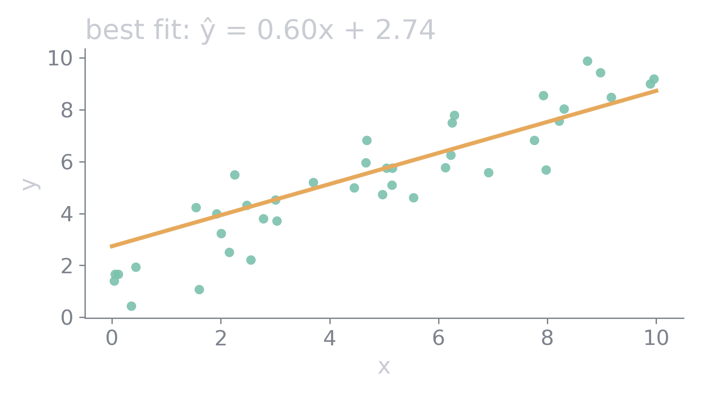
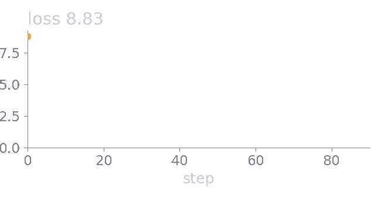

# Media in herdr-md

Press Enter on an image or a diagram to zoom it: `hjkl` or drag to pan, `+` `-` to zoom, `0` to fit, Esc to close.

## An image

## A GIF

## A video

Enter plays and pauses it, `O` opens it in QuickTime. An agent can drive it too: `mdh video demo/media.md play`.

