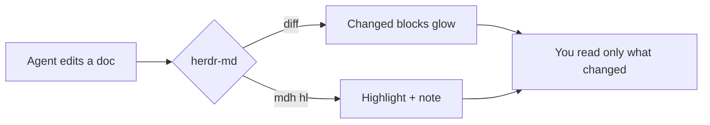

# A tour of herdr-md

A markdown pane for the Herdr desktop app that your coding agent can **point
at**. Open this file with `mdh open demo/tour.md` and press `o` for the outline.

> [!NOTE]
> Everything here is drawn natively: real font sizes, your theme's colors,
> and no terminal or web view involved.

## Reading

Headings, **bold**, *italic*, `code`, [links](#writing-math), task lists and
tables all render the way you'd expect.

- [x] Render markdown natively
- [x] Let the agent highlight passages
- [ ] Take over the world

| Key | Does |
|---|---|
| `j` / `k` | move the block cursor |
| `V`, `y`, `Enter` | select, copy, send to the agent |
| `]` / `[` | jump between changed blocks |
| `o` | outline |

> [!TIP]
> Click any heading to fold its section, or press `za`.

## Writing math

Inline math becomes Unicode: the prediction is $\hat{y} = \mathbf{w}^\top \mathbf{x} + b$.
Display math is typeset:

$$L(\mathbf{w}, b) = \frac{1}{n}\sum_{i=1}^n \frac{1}{2}\left(\mathbf{w}^\top \mathbf{x}^{(i)} + b - y^{(i)}\right)^2.$$
:eqlabel:`eq_loss`

Minimizing :eqref:`eq_loss` gives the best line through the data.

## Diagrams

## Pointing back

Select a few blocks with `V` and `j`, press `Enter`, then ask your agent
"what about this?" It runs `mdh sel` and sees exactly what you meant:
the file, the line range and the markdown source.

And when the agent rewrites part of a doc, the blocks it touched light up in
the gutter, so you only reread what changed.

## Links

Relative links open in place, and `Backspace` comes back: see
[the second page](second.md) or jump straight to [its details](second.md#details).
