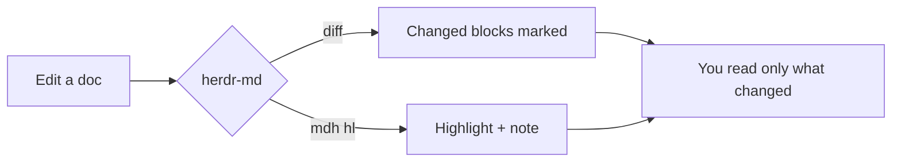

# A tour of herdr-md

Markdown rendered in a Herdr pane, read with vim keys. Open this file with
`mdh open demo/tour.md`, then press `o` for the outline or `?` for every key.

> [!NOTE]
> Everything here is drawn natively: real font sizes, your theme's colors,
> and no terminal or web view involved.

## Reading

Headings, **bold**, *italic*, `code`, [links](#writing-math), task lists and
tables all render the way you'd expect.

- [x] Read markdown in Herdr
- [x] Follow agent highlights
- [x] Review only changed blocks

| Key | Does |
|---|---|
| `j` / `k` | move the block cursor |
| `{` / `}` | previous / next heading |
| `za` | fold a section |
| `o` | outline |

> [!TIP]
> Click any heading to fold its section, or press `za`.

## Code

Code blocks take your theme's syntax colors and get a copy button.

```python
def loss(w, b, xs, ys):
    return sum((w * x + b - y) ** 2 for x, y in zip(xs, ys)) / (2 * len(xs))
```

## Writing math

Inline math becomes Unicode: the prediction is $\hat{y} = \mathbf{w}^\top \mathbf{x} + b$.
Display math is typeset:

$$L(\mathbf{w}, b) = \frac{1}{n}\sum_{i=1}^n \frac{1}{2}\left(\mathbf{w}^\top \mathbf{x}^{(i)} + b - y^{(i)}\right)^2.$$
:eqlabel:`eq_loss`

Minimizing :eqref:`eq_loss` gives the best line through the data.

## Diagrams



## Pinning for your agent

Select a few blocks with `V` and `j`, press `p` to pin them, then ask your agent
"what about this?" It runs `mdh sel` and sees exactly what you meant:
the file, the line range and the markdown source.

And when the agent rewrites part of a doc, the blocks it touched get a mark in
the gutter, so you only reread what changed.

## Links

Relative links open in place, and `Backspace` comes back: see
[the second page](second.md) or jump straight to [its details](second.md#details).
